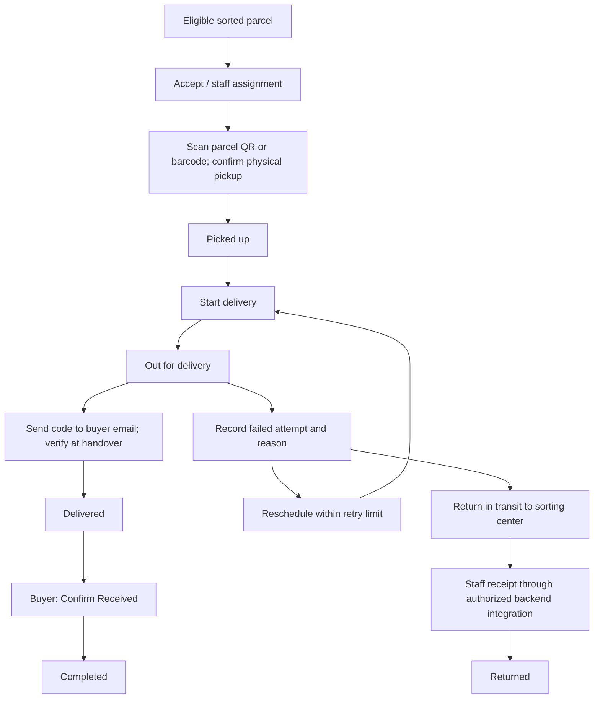

# Mobile rider workflow

**November 4 update:** [rider-requirements-implementation.md](rider-requirements-implementation.md)
supersedes the availability, onboarding, pay and delivery-evidence descriptions
below. Rider activation is invitation-only; Online is now explicit and GPS-backed.
Mandatory proof/COD/GPS, offer expiry, remittance and document review are app-local.

**ERP update:** `erp-requirements-audit.md` supersedes the original final-leg-only
scope below. Seller pickup and rider application are now supported. Sorting-center
return receipt keeps `return_in_transit`; seller physical receipt through
`delivery/confirm-seller-return` finalizes `returned`, matching the PDF definition.
Existing invitation activation and final-delivery safeguards are retained.

## Scope and architecture

All implementation is in this Flutter project and its app-local PHP API. **No
website source files have been changed.** The uninstalled website adapter was
removed following the user's scope clarification. Website work belongs to the
website team; integration requirements are documented below.

The mobile API bootstraps the existing Laravel installation and reuses its
MySQL `pocketfinds` database, models, SMTP, storage, logistics access rules,
messages and notifications. Registration remains logistics invitation followed
by account activation. Opening rider Home continues to mark the rider online.
Available tasks retain approved-account, company, operational hub, vehicle and
destination service-area checks. Acceptance is atomic; existing staff direct
assignment remains supported.

The website already has separate seller-pickup, hub-transfer and final-delivery
legs. This mobile enhancement handles the existing **final-delivery leg**: a
sorted parcel at the destination sorting center. It preserves all prior pickup,
transfer, sorting and payment prerequisites. Rider tabs remain Home, Tasks,
Earnings, History and Profile.

## Mobile flow



The database retains native `sorted` and `assigned_to_rider`; mobile task lists
display these as available and accepted. Final-leg pickup uses `picked_up`,
with a separate verified timestamp in the new verification record so the old
seller-pickup timestamp is preserved. Failure, rescheduling, return in transit
and received return are separate states. The rider cannot complete an order.
Buyer Confirm Received remains separate, and reviews require completed receipt.
New buyer confirmations leave the shipment `delivered` and complete only the
order. Legacy shipments stored as `completed` remain readable. Delivery details
and action responses expose separate `delivery_status` and `order_status` fields;
the existing shared native status names remain compatible with the website.
Canceled/completed/returned orders reject new rider mutations. After pickup,
reassignment cannot reuse another rider's verification without an authorized
handover procedure; the mobile API provides no bypass.
No rider delivery endpoint awards buyer coins, issues refunds or makes payouts.

## Files changed

| Files | Purpose |
| --- | --- |
| `api/Delivery.php` | Authorization, QR/tracking verification, OTPs, attempts, transitions, notifications and idempotency |
| `api/router.php`, `api/Actions.php`, `api/Queries.php` | Delivery routes, block legacy status bypass, atomic acceptance, buyer status visibility and receipt/review rules |
| `sql/mysql/2026_10_29_rider_workflow.sql`, `api/rider-migrate.php` | Additive schema and guarded rollback |
| `lib/services/delivery_service.dart` | REST actions, retained retry IDs, refresh events, polling and resume refresh |
| `lib/screens/rider/verified_task_detail_screen.dart`, `parcel_scanner_screen.dart` | Real scan, OTP, failure, scheduling, return, navigation, call and existing chat |
| `lib/screens/rider/task_detail_screen.dart` | Keeps the existing screen import path |
| `lib/models/shipment.dart`, `lib/services/shipment_service.dart` | Tracking, sorting-center pickup location, active/history status reads |
| Rider Home/Tasks/History/Earnings; buyer Orders/order detail | Automatic refresh, tracking status and successful-delivery-only fee calculations |
| `lib/widgets/task_card.dart`, `task_type_tag.dart`, `lib/utils/status_style.dart` | Tracking labels and status styling |
| `pubspec.yaml`, `pubspec.lock`, `ios/Runner/Info.plist` | Scanner package and camera permission description |
| `api/tests/rider.php`, `api/tests/integration.php`, new Flutter delivery service/widget tests | Authorization, concurrent requests, commerce, network errors and mobile layout checks |

## Database changes

Three additive tables were installed on this device. Existing rows and status
column types were retained:

- `delivery_verifications`: shipment primary key, pickup/rider verification,
  hashed code, recipient, expiry, attempt count, consumption/delivery timestamps,
  return request and staff receipt audit.
- `delivery_attempts`: shipment/rider, unique attempt number, predefined reason,
  notes, attempt time, scheduling time and return/reschedule decision.
- `delivery_events`: actor, action, unique shipment/request ID, keyed payload
  digest, resulting status, optional rejection and timestamp. No plaintext OTP.

Shipment/order/assignment status, native order history and buyer/seller
notifications change in one transaction. Run the repeatable installer with:

```powershell
php api/rider-migrate.php
```

`--down` removes these tables only while empty. It refuses to discard operational
records. Hub receipt does not restore seller inventory because goods have not
yet reached the seller; subsequent stock/payment resolution belongs to the
authorized website business process.

## API contract

All endpoints are POST `/delivery/{action}`, with an authenticated approved
account and UUID `shipment_id` (except `history`, which lists only the signed-in
rider's history). Mutations require UUID `request_id`, retained
when retrying the same action/payload. A request ID cannot be reused by another
actor or for another payload. Current ownership, company and destination hub
are enforced on the server, with row locks and legal transitions.

| Action | Required conditions and fields |
| --- | --- |
| `details` | Assigned rider; safe tracking, attempt/event and scheduling data; no OTP/hash |
| `history` | Approved rider; own parcels with terminal states or recorded failed attempts, including active retries; attempt counts |
| `pickup` | Accepted parcel; `parcel_code` matching an authenticated unexpired QR or unique exact existing tracking number |
| `start` | Verified pickup, or rescheduled delivery whose scheduled time has arrived |
| `request-otp` | Out for delivery; approved buyer with verified email, configured SMTP, resend cooldown and hourly cap |
| `verify-otp` | Six-digit `code`, correct recipient, valid expiry, remaining attempts and unconsumed challenge |
| `fail` | Out for delivery; allowed `reason`, optional `notes` required for Other; retry cap |
| `reschedule` | Failed attempt, retry allowance, future `scheduled_at` |
| `request-return` | Failed attempt; transitions only to `return_in_transit` |
| `label` | Destination hub staff only; retrieves tracking ID and encrypted QR with 24-hour expiry |
| `receive-return` | Correct hub staff, `return_in_transit`, exact physical `tracking_number`; records receipt before `returned` |

Failure reasons are `buyer_unavailable`, `buyer_unreachable`, `incorrect_address`,
`refused`, `otp_failed`, and `other`. Duplicate request IDs replay their actual
outcome without duplicate events. Invalid OTP attempts commit; a repeated
identical invalid request remains an error without consuming another attempt.

## QR/barcode and OTP

Existing printed parcel tracking QR/barcodes are reused. The camera scanner uses
[mobile_scanner](https://pub.dev/packages/mobile_scanner). Camera permission is
requested when opening the scanner; denied/unavailable access offers manual
tracking entry. Both paths require the assigned accepted parcel's exact unique
tracking number, validated by the backend. Signed/encrypted `PF1:` labels from
the optional staff label endpoint are also accepted; malformed, expired,
tampered or wrong-task labels are rejected.

Codes use cryptographic random generation and Laravel password hashing. They
are emailed only to the order's approved buyer with a verified email, never returned to the rider,
and invalidated on consumption, replacement or failed delivery. SMTP errors
produce errors rather than success. SMTP acceptance does not guarantee inbox
arrival. If SMTP accepts a message but the database commit then fails, that
code is invalid and another request may be needed; email and MySQL are not a
single distributed transaction.

The old mobile status-update action cannot bypass pickup/OTP verification. The
guard also protects native model operations made **inside the mobile API
process**. It does not modify or secure independent website endpoints.

## Synchronization, history and earnings

Mobile screens refresh after successful actions, every 20 seconds and on resume
using the existing REST architecture. Hidden bottom-navigation tabs stop polling
and refresh when reopened. OTP controls display server-provided attempt limits,
expiry and resend wait; the backend still validates every request.
Failed network requests do not change
local state or emit success. Buyer tracking reads the same persisted state.
Failed, rescheduled and returning tasks remain visible. History includes tracking,
event/attempt timestamps, reasons, schedules and return outcomes in task details.
Earnings aggregate the existing delivery fee once per delivered/completed
shipment; unsuccessful attempts and returns earn no successful-delivery fee.
Historical records are retained.
The Attempts filter includes prior failures after delivery resumes or succeeds.
Acceptance also creates persistent buyer/seller assignment notifications.
Retry IDs are retained by the active delivery service; this is not an offline
action queue. Reopening after disconnection reads server state before further
actions; fresh duplicate transitions are rejected by the backend.

## Website team handoff and limits

The mobile app can use the existing printed tracking label without website UI
changes. Staff-facing QR rendering and physical return receipt are not Flutter
rider actions. The website team can integrate `label` and `receive-return` using
the authorization contract above, or implement equivalent rules in their own
Laravel service. The staff account must be authenticated, approved, and assigned
to the correct operational destination hub. A rider must never receive staff
permissions or mark their own parcel returned.

Independent website rider/status endpoints still use their existing rules. The
website team must adopt equivalent verification guards to enforce scan/OTP
across **both** interfaces. Website pages read shared status changes, but their
browser polling, new status filters and staff controls remain the website team's
responsibility. Until integrated, a mobile return remains in transit until
authorized staff confirm receipt; do not bypass that wait by granting the rider
a returned action. No website installer or adapter is included.

Real camera scanning, maps/dialer behavior and delivery-code handover need an
actual phone/recipient test. Automated mail tests intercept delivery messages;
no real delivery OTP emails were sent during this task.

## Configuration and validation

SMTP comes from the existing website environment; no new SMS service or private
key is needed. Optional server environment settings:

| Variable | Default |
| --- | --- |
| `DELIVERY_OTP_MINUTES` | 10 |
| `DELIVERY_OTP_MAX_ATTEMPTS` | 5 |
| `DELIVERY_OTP_HOURLY_LIMIT` | 5 per parcel |
| `DELIVERY_MAX_ATTEMPTS` | 3 |

Resending waits 60 seconds; delivery requests are limited to 30 per action/user
per minute. Use HTTPS for deployment.

Actual checks:

- 50 rider API checks passed, including competing acceptance and concurrent
  pickup retries in independent PHP processes against actual MySQL locks.
- 41 existing integration checks passed, covering COD, GCash reservations,
  buyer confirmation, reviews, coins, messages and private media.
- 36 buyer workflow checks passed; 22 authentication checks passed in the prior authentication validation.
- 54 Flutter tests plus the new visibility-refresh regression test passed, including lost responses, rejected actions, stable
  retry IDs, narrow-screen task labels and available-task action visibility.
  The Windows concurrency workers release held test locks after a bounded pause
  and allow 180 seconds for process startup/execution; no stdin barrier is used.
- Flutter analysis passed with no issues; changed PHP files passed syntax checks.
- Android debug APK built successfully after a clean rebuild cleared stale
  compilation output in the existing share plugin.

Rider tests create a uniquely named disposable audit database with cloned
structures and remove it afterward; existing PocketFinds data is unchanged.
Other integration/auth fixtures are rolled back. Commands:

```powershell
php api/tests/rider.php
php api/tests/integration.php
php api/tests/registration.php
flutter analyze
flutter test
flutter build apk --debug
```
